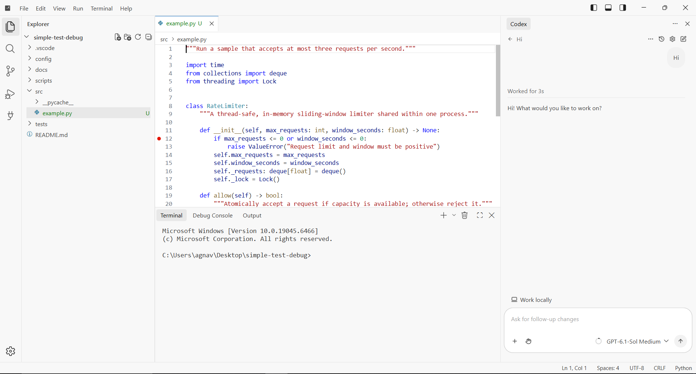

# LiteCode

[](https://github.com/krai1101/litecode/actions/workflows/build.yml)
[](LICENSE)

LiteCode is a lightweight native desktop IDE built with C++ and Qt Widgets. It
combines editing, search, Git source control, debugging, and an integrated
terminal in a native workbench. Optional native extensions include Codex and
debuggers for Python, JavaScript, and Java.



> **Beta software:** LiteCode is still in beta. Use it cautiously, keep backups
> of important work, and report problems you encounter.

## The repository

This repository is where LiteCode is developed in the open. It contains the
application source, tests, build tooling, release workflow, and the documents
needed to build and redistribute LiteCode.

## Features

- Workspace Explorer with create, rename, system-trash deletion, and Git decorations.
- Tabbed Scintilla editor with syntax highlighting, find/replace, and session
  restore.
- Quick Open, command palette, and cancellable workspace text search.
- Multiple native terminal sessions: ConPTY on Windows and PTY on Unix-like
  systems.
- Git Source Control with staging, inline diffs,
  commits, history, branches, and fetch, pull, and push. Requires Git on PATH.
- Run and Debug with breakpoints, stepping, variables,
  watches, and a debug console.
- Native C++/Qt extensions with an Extensions view for importing, enabling,
  disabling, and uninstalling packages.
- Optional `clangd` integration.
- Native Light Modern and Dark Modern themes.

Settings for editor font and file encoding apply across all folders. Resetting a setting
restores its default. Existing `<workspace>/.litecode/settings.ini` files are ignored.

## Downloads

Prebuilt packages for Windows, Linux, and macOS are published on the
[Releases page](https://github.com/krai1101/litecode/releases).

The release workflow builds and checks packages for all three platforms before
publishing. On Linux, the package uses X11 or XWayland and the system's XCB,
graphics, and font libraries.

## Bundled extensions

Starting with LiteCode 0.2.0, each release ZIP includes native extension
packages for its platform under `extensions/`:

| Extension | Setup |
| --- | --- |
| [Codex](extensions/codex/README.md) | Open the Codex sidebar after enabling and sign in with ChatGPT or use an OpenAI API key. |
| [Python Debugger](extensions/python-debugger/README.md) | Install Python. The package supplies debugpy. |
| [JavaScript Debugger](extensions/javascript-debugger/README.md) | Install Node.js and make it available on PATH. |
| [Java Debugger](extensions/java-debugger/README.md) | Install a JDK 21 or newer. |

Open **Extensions → … → Install Extension from Folder…**, select the extension's
folder from the extracted ZIP, then choose **Enable**. Each extension runs from
the installed copy. To remove an extension, right-click it and choose
**Uninstall**.

## Build from source

LiteCode requires CMake 3.24+, Ninja, a C++20 compiler, and Qt 6.11.2 with the
Core, Core5Compat, Concurrent, GUI, Widgets, SVG, Network, and Test modules.

On Windows, install Visual Studio 2022 with the Desktop development with C++
workload, then run:

```powershell
.\scripts\install-qt-windows.ps1
.\scripts\build-windows.cmd Release
.\run-litecode.cmd
```

The Qt installer script downloads the required open-source archives directly
from Qt's public repository; it does not require a Qt account or credentials.

For Linux and macOS setup, testing, formatting, and contribution requirements,
see [CONTRIBUTING.md](CONTRIBUTING.md).

## Contributing

Bug reports, feature requests, and pull requests are welcome. Read
[CONTRIBUTING.md](CONTRIBUTING.md) before submitting a change.

## Security

Please report vulnerabilities privately as described in [SECURITY.md](SECURITY.md).
Do not open a public issue for a security report.

## License and notices

LiteCode is available under the [Apache License 2.0](LICENSE).

Qt 6.11.2 is dynamically linked under LGPLv3. Third-party licenses, notices,
source records, and redistribution information are in [NOTICE.md](NOTICE.md),
[THIRD_PARTY.md](THIRD_PARTY.md), and [SBOM.spdx.json](SBOM.spdx.json).
